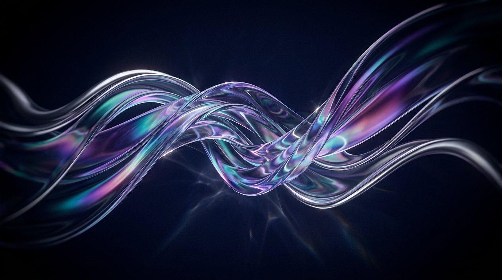

# Liquid Glass Studio — Windows 11 theme builder

An interactive design studio for a **liquid glass** take on Windows 11. Tune one glass
recipe and watch it apply live across a working **File Explorer**, **Task Manager** and
**Settings** mock — then export a real Windows 11 theme pack.



## What it does

- **Three real app surfaces** — Explorer (tabs, breadcrumbs, command bar, sidebar, thumbnail
  grid, details pane), Task Manager (live process table with CPU heat cells, sparklines,
  Performance tab with graphs) and Settings (Personalization, plus ten other mock pages).
- **One glass recipe, everywhere** — blur, saturation, brightness, tint colour/opacity,
  corner radius, refractive rim, specular sweep, depth shadow, frost grain and edge-lens bend
  are CSS custom properties shared by every surface, in light or dark mode.
- **Windows shell** — draggable/resizable speech-bubble-free windows, maximize/restore,
  taskbar with running indicators, a real Start menu with search, desktop icons, tray flyouts.
- **Six presets** — Liquid Glass, Frosted Mica, Liquid Chrome, Aurora Neon, Arctic Day (light)
  and Obsidian Smoke. Everything is saved to `localStorage` as you tweak.
- **Export a theme pack** (see below) — a `.theme` file, wallpaper, CSS tokens, preset JSON,
  README and a one-step PowerShell installer, zipped client-side.

## Run it

```bash
npm install
npm run dev      # http://localhost:5173
npm run build    # type-check + production build into dist/
npm run preview
```

Keyboard: `Esc` closes Start · `Ctrl/⌘ + Shift + D` toggles the design panel.

## The glass recipe

| Token | What it changes |
| --- | --- |
| Backdrop blur | `backdrop-filter: blur()` on every surface |
| Saturation / brightness | how much wallpaper colour bleeds through |
| Tint + opacity | the glass body colour and its transparency |
| Corner radius | shared by windows, tiles, cards and inputs |
| Rim thickness + lens bend | the thick refractive edge (masked backdrop-filter) |
| Specular highlight | the diagonal sheen sweeping the top-left |
| Depth shadow | stacked window elevation |
| Frost grain | fine noise, like acid-etched glass |

A depth-shade layer is computed from tint opacity so text stays legible over bright
wallpapers — that is why the light "Arctic Day" preset still reads clearly.

## Theme pack export

Clicking **Export theme pack** builds a zip in the browser:

```
Liquid Glass/
├─ Liquid Glass.theme      display name, accent + colorization, dark/light mode, wallpaper
├─ wallpaper.jpg           16:9 wallpaper matching the design
├─ install.ps1             copies the theme to %LOCALAPPDATA%\Microsoft\Windows\Themes and applies it
├─ glass-tokens.css        the exact glass recipe as CSS custom properties + .glass rules
├─ preset.json             all settings, importable back into Studio ("Import JSON")
└─ README.md               install steps and deeper-glass guidance
```

On Windows 11: unzip, then right-click `install.ps1` → *Run with PowerShell*.

**Honest scope:** a `.theme` file can set wallpaper, accent colour, light/dark mode and cursors.
Windows' own acrylic/mica is applied by the compositor and cannot be replaced per-window by a
theme file. For true liquid glass on the actual shell, pair the pack with a compositor tool —
Windhawk, DWMBlurGlass, TranslucentTB or StartAllBack — as described in the exported README.
The CSS tokens are the same recipe used in this preview, so you can carry the look into web or
Electron apps directly.

## Stack

React 18 · TypeScript · Vite 6 · lucide-react icons · JSZip · hand-written CSS (no UI kit).
Wallpapers are generated artwork served from `public/wallpapers`.
